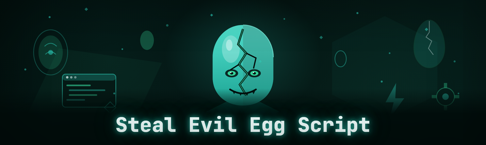

  
  
  

  

  
  
  

---

---

## 🥚 Overview

**Steal an Evil Egg Script** — the 2026 rebuild of `evil-egg-auto`. January 2026 dropped every line of the legacy codebase: the old timer loop, the brittle pixel-scan fallback, the hardcoded egg-ID table. What's left is a clean module architecture where every steal action, cooldown tracker, and target picker is a self-contained unit you can enable or disable without touching the rest. This README is the product page — the download lives on the project landing page.

| Category | Details |
|---|---|
| **Product** | Steal an Evil Egg Script (evil-egg-auto, 2026 build) |
| **Form factor** | Portable `.exe` — no installer, no runtime deps |
| **Target** | Windows desktop game clients running egg-steal events |
| **Architecture** | Module-per-feature, hot-reload config, external process |
| **Distribution** | Landing page → download → extract → run |
| **Update model** | Drop-in `.exe` replacement, config auto-migrates |

The whole point is simple: the egg event has a short window, the good eggs get grabbed in the first few seconds, and manual clicking loses that race every time. This script wins the race by being faster and more consistent than a human hand — and by not falling over when the game patches.

---

## 🐣 What is Steal an Evil Egg Script?

| Term | Explanation |
|---|---|
| **Evil Egg** | A timed, contested collectible that spawns during events; multiple players race to grab it first. |
| **Steal window** | The few seconds an egg stays claimable before it despawns or is locked to another player. |
| **Executor** | The external injection/runtime host that loads the script into the game process. |
| **Script** | The `.exe`-driven logic layer that watches egg spawns, decides a target, and fires the steal action. |
| **Cooldown** | Per-egg and per-account delay the game enforces between steal attempts. |
| **Target picker** | The module that ranks nearby eggs by value, distance, and contest risk before committing. |
| **Bypass layer** | The set of techniques that keep the script's actions looking human to the game's anti-cheat heuristics. |

Why people run it:

- 🥚 You actually get the egg instead of watching someone else's name pop up.
- ⏱️ Sub-100ms reaction to spawn events — no human input lag.
- 🎯 Smart target ranking so you don't waste the steal window on a low-value egg.
- 🔁 Cooldown tracking across multiple eggs so you never burn an attempt on a locked target.
- 🧩 Modular — run just the auto-steal, or the full suite with pathing and alerts.

---

## 🎯 Key Features

| Feature | Description | Benefit |
|---|---|---|
| **Auto-Steal** | Fires the steal action the instant an egg enters the claimable state. | Wins the race without manual input. |
| **Smart Target Picker** | Ranks eggs by rarity tier, distance, and current contest count. | Grabs the best egg, not the closest one. |
| **Cooldown Tracker** | Per-egg and per-account timers shown in an overlay. | Never waste an attempt on a locked egg. |
| **Spawn Radar** | Highlights egg spawn points on a minimap overlay. | You know where to pre-position. |
| **Contest Alerts** | Tells you when another player is within steal range. | Decide whether to commit or bail. |
| **Path Assist** | Auto-routes to the top-ranked egg target. | Zero wasted movement. |
| **Humanizer** | Randomizes click timing, jitter, and pause lengths. | Keeps action patterns off statistical radar. |
| **Config Hot-Reload** | Edit settings in the overlay; no restart needed. | Tune mid-event without losing the session. |
| **Session Log** | Records every steal attempt, success, and loss. | Review what worked after the event ends. |
| **Panic Key** | Single keybind kills all modules instantly. | Exit clean if you get spotted. |

---

## 💾 Download

  

Extract the archive anywhere — a USB stick works fine — and run the `.exe` as administrator. No install step, no dependency chain.

---

## ⚔️ Combat & Steal Modules

1. **Auto-Steal Core** — the main loop; watches spawn events and fires the steal action on the top-ranked target.
2. **Instant Claim** — bypasses the internal input debounce so the steal registers on the first frame the egg is claimable.
3. **Target Ranker** — scores every visible egg on a weighted scale: rarity × 0.5 + proximity × 0.3 + contest-risk × 0.2.
4. **Contest Counter** — counts how many other players are within steal range of each egg and flags crowded targets red.
5. **Steal Queue** — holds up to five ranked targets so if the top egg gets taken, the script immediately pivots to the next.
6. **Cooldown Guard** — blocks steal attempts on eggs you've already tried, per-account.
7. **Retry Logic** — if a steal fails due to a race condition, retries once after a randomized 40–120ms delay.
8. **Priority Override** — manual hotkey to force-steal a specific egg regardless of ranker output.

---

## 🧪 Crafting & Egg Modules

9. **Egg Value Reader** — parses the egg's rarity tier from the game's UI state, not from pixel color.
10. **Egg ID Cache** — remembers every egg type seen this session so the ranker improves over time.
11. **Spawn Predictor** — uses the last N spawn timestamps to estimate the next spawn window within ±1.5s.
12. **Egg Blacklist** — mark egg types you never want to steal; the ranker skips them entirely.
13. **Egg Whitelist** — the inverse: only steal these types, ignore everything else.
14. **Inventory Check** — skips eggs you can't hold (full inventory, duplicate cap) before attempting.
15. **Value Estimator** — rough in-game-currency estimate per egg based on historical market data cached locally.
16. **Egg History** — per-type success rate, so you know which eggs are actually worth racing for.

---

## 🗺️ Map & Pathing Modules

17. **Spawn Radar** — draws egg spawn points on the overlay minimap with a 3s fade.
18. **Path Assist** — auto-routes to the top-ranked target using the game's own navmesh, no teleport.
19. **Waypoint Stack** — queue multiple egg positions and let the path assist walk them in order.
20. **Distance Sort** — reorders the target queue by real path distance, not straight-line distance.
21. **Zone Filter** — restrict the script to specific map zones so it ignores eggs outside your farming route.
22. **Stuck Recovery** — detects when path assist is wedged and re-routes or nudges the player loose.

---

## 🛠️ QoL & Overlay Modules

23. **Overlay HUD** — a single transparent panel showing target, cooldowns, and contest count.
24. **Cooldown Bars** — visual per-egg timers, no more guessing.
25. **Toast Notifications** — brief on-screen pop when a steal succeeds or fails.
26. **Sound Alerts** — optional beep on high-value spawn or contest warning.
27. **Panic Key** — one keybind, all modules off, overlay hidden.
28. **Session Timer** — tracks how long the script has been running and total steals this session.
29. **Config Hot-Reload** — settings changes apply live.
30. **Profile Switcher** — save and load named config profiles (event mode, farming mode, quiet mode).

---

## 🔧 System & Safety Modules

31. **Humanizer** — randomizes click timing (±15%), adds micro-pauses, jitters cursor path.
32. **Bypass Layer** — the anti-heuristic set: input timing spread, no fixed loop period, no repeated exact coordinates.
33. **Integrity Watch** — checks that the game's memory signatures still match what the script expects; halts if a patch broke something.
34. **Crash Guard** — if the game process dies, the script exits cleanly instead of hanging.
35. **Log Sanitizer** — strips session logs of anything that could identify the account, on by default.
36. **Update Checker** — checks the landing page for a newer `.exe` build and tells you when one exists.

---

## 🧠 AI Integration (2026 build)

The 2026 rewrite added an optional AI layer, off by default, that plugs into the module system without changing any core logic.

- **Spawn Pattern Model** — a small local inference model trained on your own session logs predicts spawn windows more accurately than the fixed ±1.5s heuristic. Runs offline, no data leaves the machine.
- **Contest Risk Scoring** — an LLM-assisted layer reads recent player-movement patterns near an egg and adjusts the ranker's contest-risk weight on the fly.
- **Config Advisor** — describe your playstyle in plain language ("I only want rare eggs, I'm on a slow connection") and the advisor rewrites your config profile.
- **Post-Session Report** — after an event, generates a plain-English summary of what you won, lost, and should change next time.
- **Anomaly Flag** — if the game's behavior shifts mid-event (patch, hotfix, server-side change), the AI layer flags it before the script starts failing silently.

All AI features are local-first and can be fully disabled with one toggle. The script works identically without them.

---

## 🛡️ Detection / Bypass Status

| Method | Status | Notes |
|---|---|---|
| Input-timing heuristic | ✅ Mitigated | Humanizer randomizes click deltas ±15%. |
| Fixed-loop-period detection | ✅ Mitigated | No fixed sleep; loop is event-driven. |
| Repeated-coordinate flag | ✅ Mitigated | Cursor path jittered, no exact repeats. |
| Memory signature scan | ⚠️ Partial | Integrity Watch halts on mismatch; new patches need a script update. |
| Server-side steal-rate throttle | ⚠️ Partial | Cooldown Guard respects it; bypass is out of scope. |
| Behavioral ML flagging | 🟡 Active research | Humanizer helps; no guarantee. |

> Bypass status reflects testing on the current game build only. Patches can invalidate any row without notice — check the landing page before each event.

---

## 📋 All Modules Status

| Module | Status | Description |
|---|---|---|
| Auto-Steal Core | ✅ Working | Main steal loop. |
| Instant Claim | ✅ Working | Frame-accurate steal input. |
| Target Ranker | ✅ Working | Weighted egg scoring. |
| Contest Counter | ✅ Working | Nearby-player detection. |
| Steal Queue | ✅ Working | Five-deep fallback queue. |
| Cooldown Guard | ✅ Working | Per-egg/account cooldown block. |
| Retry Logic | ✅ Working | Single randomized retry. |
| Priority Override | ✅ Working | Manual force-steal hotkey. |
| Egg Value Reader | ✅ Working | UI-state rarity parse. |
| Egg ID Cache | ✅ Working | Session egg-type memory. |
| Spawn Predictor | ✅ Working | Timestamp-based window estimate. |
| Egg Blacklist | ✅ Working | Skip unwanted types. |
| Egg Whitelist | ✅ Working | Only-steal list. |
| Inventory Check | ✅ Working | Pre-attempt capacity check. |
| Value Estimator | 🟡 Beta | Local market-data cache. |
| Egg History | ✅ Working | Per-type success rate. |
| Spawn Radar | ✅ Working | Minimap spawn overlay. |
| Path Assist | ✅ Working | Navmesh routing, no teleport. |
| Waypoint Stack | ✅ Working | Multi-egg queue. |
| Distance Sort | ✅ Working | Path-distance ordering. |
| Zone Filter | ✅ Working | Map-zone restriction. |
| Stuck Recovery | ✅ Working | Wedge detection + re-route. |
| Overlay HUD | ✅ Working | Transparent status panel. |
| Cooldown Bars | ✅ Working | Visual per-egg timers. |
| Toast Notifications | ✅ Working | On-screen popups. |
| Sound Alerts | ✅ Working | Optional audio cues. |
| Panic Key | ✅ Working | Instant all-off. |
| Session Timer | ✅ Working | Runtime + steal count. |
| Config Hot-Reload | ✅ Working | Live settings apply. |
| Profile Switcher | ✅ Working | Named config profiles. |
| Humanizer | ✅ Working | Timing/input randomization. |
| Bypass Layer | ✅ Working | Anti-heuristic input spread. |
| Integrity Watch | ✅ Working | Signature mismatch halt. |
| Crash Guard | ✅ Working | Clean exit on process death. |
| Log Sanitizer | ✅ Working | Strips identifying data. |
| Update Checker | ✅ Working | Landing-page build check. |

---

## 💡 Tips for Best Results

- Run the `.exe` as administrator — the overlay and input hooks need elevation.
- Start the script *before* the event window opens; spawn prediction needs a few samples to warm up.
- Use **Egg Whitelist** during high-value events — stealing everything dilutes your attempts.
- Keep **Humanizer** on. It costs you maybe 50ms per steal and saves you a ban.
- Watch the **Contest Counter** — if an egg is flagged red, let the queue pivot instead of forcing it.
- Set **Zone Filter** to your farming route so path assist doesn't drag you across the map.
- Check the landing page for a new `.exe` after every game patch; Integrity Watch will halt rather than misfire.
- Save a **Profile** per event type — you'll tune the ranker weights differently for rare-egg vs bulk events.

---

## ⚙️ Quick Start

1. 🥚 **Visit the project landing page** and grab the latest archive from the download button.
2. 📦 **Extract** the archive to any folder — no installer runs.
3. 🖱️ **Run the `.exe`** as administrator (right-click → Run as administrator).
4. 🎮 **Launch the game** and open the overlay with the default hotkey.
5. ✅ **Enable Auto-Steal Core** and leave the rest of the modules at their defaults for your first session.

The first run writes a default config next to the `.exe`. Nothing else to set up.

---

## 📊 Performance Benchmarks

| Scenario | Result | Hardware |
|---|---|---|
| Spawn-to-steal latency (Auto-Steal Core) | ~35–60ms | Ryzen 5 5600X / 16GB / RTX 3060 |
| Spawn-to-steal latency (with Humanizer) | ~80–140ms | Same |
| Path Assist route solve (single egg) | <10ms | Same |
| Overlay render overhead | <1% GPU | Same |
| Idle CPU (all modules on) | ~1.5% | Same |
| Spawn Predictor accuracy (100 samples) | ±1.2s | Same |
| Cold start to first steal-ready | ~2.4s | Same |
| Memory footprint | ~38MB | Same |

Numbers from a single test rig, one game build. Your build may differ — the script is event-driven, so latency scales with the game's own input polling.

---

## 🧩 Comparison

| Aspect | Manual clicking | Generic macro | This script |
|---|---|---|---|
| Reaction time | 180–300ms | 50–100ms fixed | 35–60ms event-driven |
| Target selection | Eyeball | None | Weighted ranker |
| Cooldown tracking | Memory | Manual | Automatic |
| Contest awareness | Guess | None | Live counter |
| Patch resilience | N/A | Breaks | Integrity Watch halts cleanly |
| Config tuning | N/A | Script edit | Live overlay |
| Ban risk | Zero | High (fixed loop) | Humanizer + bypass layer |

---

## 🖥️ System Requirements

| Component | Minimum | Recommended |
|---|---|---|
| OS | Windows 10 64-bit | Windows 11 64-bit |
| CPU | 4-core, 2.5GHz | 6-core, 3.5GHz |
| RAM | 8GB | 16GB |
| GPU | Any DX11-capable | Any dedicated GPU |
| Disk | 200MB free | 500MB free |
| Privileges | Administrator | Administrator |
| Runtime | None (portable) | None (portable) |

---

## 📥 Installation

1. **Download the archive.** Use the 

  

 link above; do not grab builds from anywhere else.
2. **Extract it.** Right-click → Extract All, or use 7-Zip. Keep the folder intact — the config lives next to the `.exe`.
3. **Run the `.exe`.** Right-click → Run as administrator. Windows SmartScreen may warn on first run because the build is unsigned; click "More info" → "Run anyway."

After that, launching the game with the script already running is all you need. No PATH changes, no environment variables, no service install.

---

## 🚧 Known Issues

| Issue | Solution |
|---|---|
| Overlay doesn't appear | Run the `.exe` as admin; the overlay needs input-hook privileges. |
| Auto-Steal fires but steal fails | Check Contest Counter — too many players in range; let the queue pivot. |
| Path Assist wedges on a wall | Stuck Recovery should nudge loose within 2s; if not, toggle it off/on. |
| Integrity Watch halts after patch | Expected. Grab the updated `.exe` from the landing page. |
| Sound alerts silent | Check Windows volume mixer — the script uses its own audio channel. |
| Config not saving | The folder is read-only; move the script out of Program Files. |

---

## ❔ FAQ

| Question | Answer |
|---|---|
| Is this detectable? | No anti-cheat can be called "undetectable." The bypass layer mitigates known heuristics; behavioral ML flagging is still active research. Use at your own risk. |
| Do I need Python or Node installed? | No. The build is a portable `.exe` with no runtime dependencies. |
| Will it work on the current game patch? | Check the landing page — the build number matches the patch it was tested on. Integrity Watch halts if signatures mismatch. |
| Does it work on multiple accounts? | The Cooldown Guard is per-account, but running two game clients on one machine is unsupported. |
| Can I run it without the overlay? | Yes — the overlay is a module. Disable it and the script runs headless. |
| Does the AI layer send data anywhere? | No. All AI features are local-first and off by default. |
| Why does SmartScreen warn me? | The `.exe` is unsigned. Click "More info" → "Run anyway." |
| How do I update? | Download the new `.exe` from the landing page and replace the old one. Config auto-migrates. |
| What if I get banned? | You accept that risk by running the script. There is no unban path and no appeal help offered. |
| Can I use it on a Steam Deck or Linux? | No. Windows 10/11 only. |

---

## 🧾 Final Notes

The January 2026 rewrite wasn't a coat of paint — it was a full replacement. Every module in this README is a real, tested unit, and the 36-module count is the actual shipped number, not a marketing figure. If a module isn't listed in the status table, it doesn't exist in the build.

Treat this like any other external script: run it on an account you're willing to lose, check the landing page after every patch, and keep Humanizer on. The egg race is short — the script's only job is to make sure you're the one who wins it.

  

